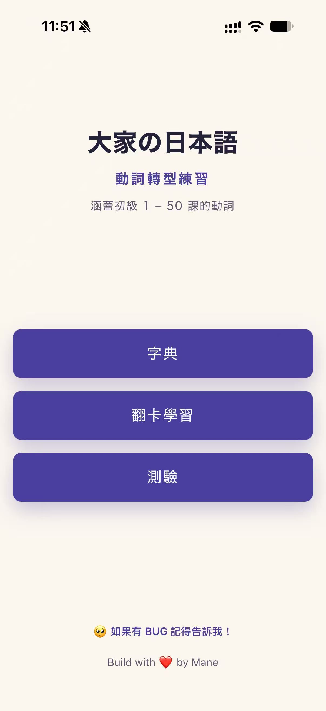

# 大家の動詞轉型練習：初級篇

<p align="center">
  
</p>

一個練《大家的日本語》初級 1 – 50 課動詞變化（活用）的小網站。打開網頁就能用：

| iPhone | PC |
|---|---|
|  |  |

不用註冊、不用安裝、不用付費，手機跟電腦都可以。

**▶ 立即開始遊玩：<https://manesec-web.github.io/game-japanese-katsuyou-basic/>**


## 這是做什麼的？

學日文動詞最頭痛的就是「變化」：同一個動詞，否定要變、過去要變，還有
可能、使役、被動⋯⋯一個動詞就有十幾種長相。這個網站把《大家的日本語》
初級 50 課、386 個動詞的 15 種變化形全部整理好，讓你查、讓你背、讓你考自己。

## 四個入口

**📚 學習 — 當文法書用**
不想考自己，只想搞懂「為什麼會這樣變」的時候按這裡。目錄列出 15 種
變化形，點一個就進「變形說明」：用「從／到」選兩個形式，頁面會依
三類動詞和例外，畫出語尾怎麼刪、假名怎麼換段或音便，並附上真實單詞
的對照表與小提醒。下面的「例如」可以挑字典裡任一動詞，把這次的變形
原理拆給你看；「小提示」整理口訣和常見陷阱（う→わ、行く、帰る…）。
在字典裡看到某個形，也可以直接按該形的「變形原理」跳來這裡。

**📖 字典 — 當工具書用**
一次看一個動詞：15 種變化形、讀音、中文意思、例句全部列出來。每一形
都有自己的中文解釋（否定是什麼意思、過去是什麼意思，各不相同），容易
用錯的地方也標在旁邊。右上角的「目錄」列出這次選的課次裡每個動詞的
每一種形式，可以直接跳過去，也能用單詞、平假名讀音、羅馬字或課號搜尋
（`dekimasu` 找得到「できます」）。點一下日文單詞或例句，就會唸出它的
日文發音。

**🃏 翻卡練習 — 當背卡用**
正面給你一個動詞，提示「變成＿＿形」，猜猜看答案是什麼；點一下翻開。
記住了就滑下一張，最後一張滑走就是「完成」。

**✏️ 測驗 — 當考試用**
題目給原形，用螢幕上的假名鍵盤把正確的變化形拼出來。答對馬上進下一題；
答錯會抖一下提醒你，錯三次才給答案，看完按「下一題」才繼續——不會自己
跳走。

## 怎麼用

1. 打開上面的網址，等字典載入完（第一次要下載資料，之後就快了）。
2. 首頁選「學習」看變形原理，或選字典、翻卡練習、測驗開始練習。
3. 練習時選要練的課次（可以一鍵全選），再選要從什麼形變成什麼形。
4. 按「開始」就好。隨時可以按右上角的齒輪改設定。
5. 你的選擇都記在自己的裝置裡，下次打開不用重選；「學習」裡的
   從／到和範例單詞則是當次瀏覽的暫時選擇，不存進設定。

**小提示**：

- 第 1、3、8、12 課沒有動詞，是灰色的、不能選，這是正常的。
- 點日文單詞或例句會播放發音；第一次點某課會先下載那一課的錄音（會
  一閃一閃），之後就存在裝置裡，再點不用重新下載。
- 「跳過錯誤的單詞」可以自己開關：有些變化形文法上不成立，只是為了練
  轉型才列出來，不想看到就把它們跳過。
- 設定裡還可以挑要顯示哪幾種變化形、要不要標平假名注音等等。
- 「變形說明」的從／到總共 15 × 14 = 210 種組合，每一種都有按真實
  字典動詞編好的說明，不是套同一句公式。

## 在 iPhone 上使用

本程式已經在 iPhone 上適配完成。對於 iPhone 上的 Safari，你可以把網站
變成 App：

1. 使用 Safari 打開 <https://manesec-web.github.io/game-japanese-katsuyou-basic/>。
2. 點一下「分享」按鈕，向下捲動選項列表，然後點一下「加入主畫面」。

參考：<https://mrmad.com.tw/how-to-iphone-web-page-on-desktop>

## 常見問題

**需要安裝什麼嗎？**
不用。打開上面的網址就好，手機、電腦的瀏覽器都行。

**要註冊嗎？要付錢嗎？**
都不用。沒有帳號，你的設定跟資料都只存在自己的裝置裡。

**第一次打開要等一下？**
正常。字典資料壓縮後約 0.5 MB，載入條會跟著下載進度跑；第一次載入後
會存在裝置裡，之後再打開不用重新下載。

**發現錯字或 BUG？**
歡迎回報，謝謝你！

## 回報問題

- 送出 issue：<https://github.com/manesec-web/game-japanese-katsuyou-basic/issues/>
- 或來信：<mane@manesec.com>

## 自己跑一份／想要改程式碼

技術細節都收在 `docs/`，README 只講人話：

| 文件 | 內容 |
|---|---|
| [`AGENTS.md`](AGENTS.md) | 給下一位開發者的執行計畫、命令表與驗收清單 |
| [`docs/development.md`](docs/development.md) | 開發環境、指令、專案結構、資料模型、測試與部署 |
| [`docs/spec.md`](docs/spec.md) | 產品行為的權威規格（畫面、文案、手勢、資料、設定） |
| [`docs/architecture.md`](docs/architecture.md) | 命令契約、session、檔案對應、測試策略 |
| [`docs/progress.md`](docs/progress.md) | 目前狀態、已執行的驗證、已知限制 |
| [`docs/roadmap.md`](docs/roadmap.md) | 任務板與各次修訂的驗收紀錄 |
| [`docs/changelog.md`](docs/changelog.md) | 依日期記錄的變更與原因 |
| [`docs/serving.md`](docs/serving.md) | 本機伺服與載入失敗排查 |
| [`docs/logo/README.md`](docs/logo/README.md) | 分頁圖示的來源與轉檔方式 |
| `docs/audit/*.md` | 各次字典校對的歷史快照（不是目前規格） |

想在自己電腦上跑起來，只要兩行（需要 Node.js 20.19+ 或 22.12+）：

```bash
npm install
npm run dev
```

其他指令（建置、測試、部署到 GitHub Pages）見
[`docs/development.md`](docs/development.md)。建置前會檢查字典與錄音檔的
雜湊、重新產生 210 筆變形說明，並從 release 下載 46 個錄音檔，所以
`npm run build` 需要網路；`output/` 不進版本庫。

---

值得注意，該 APP 不是官方出品，且字典資料出自《大家的日本語》，僅供學習使用。

Build with ❤ by Mane
